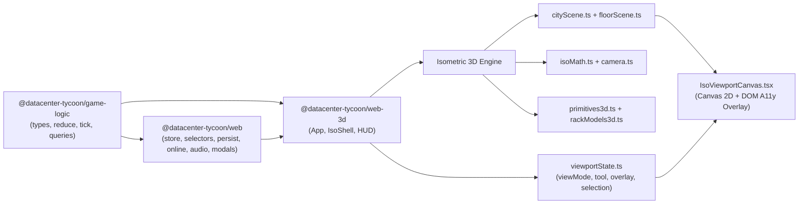

## Progress

- [x] **Phase 1 — Plan File & Workspace Configuration**
  - [x] 1.1 Create `.agents/plans/053-isometric-3d-web-client.md` and update `.agents/plans/README.md`
  - [x] 1.2 Export shared basics from `packages/web/src/index.ts` and `packages/web/package.json`
  - [x] 1.3 Scaffold `packages/web-3d` config files and update root `package.json`
  - [x] 1.4 Install workspace dependencies & build `@datacenter-tycoon/game-logic`
- [x] **Phase 2 — Isometric 3D Math, Camera, Primitives & Procedural Rack Models**
  - [x] 2.1 Implement `isoMath.ts` + `isoMath.test.ts`
  - [x] 2.2 Implement `camera.ts` + `camera.test.ts`
  - [x] 2.3 Implement `primitives3d.ts` + `primitives3d.test.ts`
  - [x] 2.4 Implement `rackModels3d.ts` + `rackModels3d.test.ts`
- [x] **Phase 3 — 3D Datacenter Cutaway Scene & Cities: Skylines District Scene**
  - [x] 3.1 Implement `floorScene.ts` + `floorScene.test.ts`
  - [x] 3.2 Implement `cityScene.ts` + `cityScene.test.ts`
- [x] **Phase 4 — Cities: Skylines HUD, Interactive 3D Viewport & Game Loop Integration**
  - [x] 4.1 Implement `viewportState.ts` + `viewportState.test.ts`
  - [x] 4.2 Implement `IsoViewportCanvas.tsx` + `IsoViewportCanvas.test.tsx`
  - [x] 4.3 Implement Cities: Skylines HUD (`TopHudBar`, `InfoOverlayDock`, `SkylinesBuildDock`, `InspectorPanel`) + `hud.test.tsx`
  - [x] 4.4 Implement `IsoShell.tsx`, `App.tsx`, `main.tsx`, `index.ts` + `IsoShell.test.tsx` & `query-boundary.test.ts`
- [x] **Phase 5 — Full Verification & Plan Completion**
  - [x] 5.1 Run `typecheck`, `test`, `audit:query-boundary`, `build`, and `lint` across workspaces
  - [x] 5.2 Mark plan completed and update `.agents/plans/README.md`

## Overview

Build `@datacenter-tycoon/web-3d` in `packages/web-3d/`, a Cities: Skylines-inspired isometric 3D web client for Datacenter Tycoon. The client reuses the authoritative simulation core (`@datacenter-tycoon/game-logic`) and imports the shared store, selectors, persistence, online leaderboard/verified-run sync, audio engine, theme tokens, and management dialogs directly from the 2D web client (`@datacenter-tycoon/web`). On top of those shared foundations, it renders two synchronized isometric 3D worlds in an interactive HTML5 Canvas 2D + accessible DOM overlay engine: a **City District Skyline** view (12×12 zoned city blocks, animated vehicles, municipal power/fiber/workforce buildings, upgrade-reactive 3D datacenter campuses, and clickable vacant lots) and a **Facility 3D Cutaway** view (raised floor slab with under-floor chilled-water and power conduits, cutaway CRAC/PDU/NOC walls, maintenance technicians, hot/cold aisles, procedural Tier 0–3 compute/memory/storage/GPU racks, and Cities: Skylines info-overlay heatmaps).

## Architecture



Key decisions:
- **Zero uncached runtime dependencies**: Pure TypeScript Canvas 2D isometric 3D engine with exact 4-angle rotation (`0 | 1 | 2 | 3`), painter's-algorithm depth sorting, and inverse raycasting.
- **Reuse from `@datacenter-tycoon/web`**: Store, selectors, `persist.ts`, `online/*`, `AudioEngine`, `StartScreen`, and management modals (`RackPicker`, `MoveRackModal`, `NewDatacenterModal`, `ContractsPage`, `FinancesPage`, `PowerView`, `MapView`, `LogFeed`, `TutorialModal`, `AudioSettingsModal`, `ResetGameModal`) are imported rather than duplicated.
- **Query-boundary compliance**: All infrastructure capacities, contract buckets, fit checks, and rack move/maintenance/activity views flow through `@datacenter-tycoon/web` selectors backed by `@datacenter-tycoon/game-logic`.

```ts
export type IsoRotation = 0 | 1 | 2 | 3;
export type InfoOverlayMode = "standard" | "power" | "thermal" | "network" | "maintenance";
export type CameraViewMode = "city" | "facility";

export type BuildTool =
  | { mode: "select" }
  | { mode: "place_rack"; specId: RackSpecId }
  | { mode: "bulldozer" }
  | { mode: "build_dc"; specId?: DatacenterSpecId };
```

## Phase 1 — Plan File & Workspace Configuration

**Goal**: Document the plan, expose shared exports from `@datacenter-tycoon/web`, scaffold `packages/web-3d`, and install workspace dependencies.

### Step 1.1 — Create `.agents/plans/053-isometric-3d-web-client.md` and update `.agents/plans/README.md`
- Files: `.agents/plans/053-isometric-3d-web-client.md`, `.agents/plans/README.md`
- Acceptance: Plan file and README index exist following `planning/SKILL.md`.

### Step 1.2 — Export shared basics from `packages/web/src/index.ts` and `packages/web/package.json`
- Files: `packages/web/package.json`, `packages/web/src/index.ts`
- Add `"exports"` map to `packages/web/package.json` and re-export store, selectors, persist, gameTime, tickDriver, tickFractionStore, playerIdentity, tutorialPersist, ids, online helpers, audio engine, router helpers, responsive/dialogFocus hooks, theme primitives, and reusable modals/views from `packages/web/src/index.ts`.
- Acceptance: `packages/web/src/index.test.ts` and all `packages/web` tests continue to pass.

### Step 1.3 — Scaffold `packages/web-3d` config files and update root `package.json`
- Files: `package.json`, `packages/web-3d/package.json`, `packages/web-3d/tsconfig.json`, `packages/web-3d/vite.config.ts`, `packages/web-3d/eslint.config.mjs`, `packages/web-3d/index.html`, `packages/web-3d/.env.example`, `packages/web-3d/.env.production`, `packages/web-3d/AGENTS.md`, `packages/web-3d/README.md`, `packages/web-3d/src/test-setup.ts`.
- Acceptance: Workspace configuration and `audit:query-boundary` include `packages/web-3d`.

### Step 1.4 — Install workspace dependencies & build `@datacenter-tycoon/game-logic`
- Run `npm install` (with `BypassSandbox: true` when sandboxed network blocks) and `npm run build:logic`, plus `npm run test -w @datacenter-tycoon/web`.
- Acceptance: `node_modules` installed and `@datacenter-tycoon/web` tests pass.

## Phase 2 — Isometric 3D Math, Camera, Primitives & Procedural Rack Models

**Goal**: Build the deterministic isometric 3D projection math, camera controller, Canvas 2D 3D primitives, and procedural Tier 0–3 rack renderers.

### Step 2.1 — Implement `isoMath.ts` + `isoMath.test.ts`
- Files: `packages/web-3d/src/engine/isoMath.ts`, `packages/web-3d/src/engine/isoMath.test.ts`
- Acceptance: Unit tests pass for projection, inverse grid picking, 4-angle rotation, depth sorting, and polygon hit-testing.

### Step 2.2 — Implement `camera.ts` + `camera.test.ts`
- Files: `packages/web-3d/src/engine/camera.ts`, `packages/web-3d/src/engine/camera.test.ts`
- Acceptance: Unit tests pass for pan, zoom-at-cursor clamping, 90° CW/CCW rotation, cutaway toggle, and grid auto-fit.

### Step 2.3 — Implement `primitives3d.ts` + `primitives3d.test.ts`
- Files: `packages/web-3d/src/engine/primitives3d.ts`, `packages/web-3d/src/engine/primitives3d.test.ts`
- Acceptance: Unit tests pass for tiles, extruded boxes, cylinders, pipes/conduits, and floating 3D badges.

### Step 2.4 — Implement `rackModels3d.ts` + `rackModels3d.test.ts`
- Files: `packages/web-3d/src/engine/rackModels3d.ts`, `packages/web-3d/src/engine/rackModels3d.test.ts`
- Acceptance: Unit tests pass for Tier 0–3 geometry, kind accents, live operational states, ghost racks, and all 5 `InfoOverlayMode` views.

## Phase 3 — 3D Datacenter Cutaway Scene & Cities: Skylines District Scene

**Goal**: Implement both full-world isometric 3D scenes with painter's-algorithm depth sorting and hit-testing.

### Step 3.1 — Implement `floorScene.ts` + `floorScene.test.ts`
- Files: `packages/web-3d/src/engine/floorScene.ts`, `packages/web-3d/src/engine/floorScene.test.ts`
- Acceptance: Unit tests pass for facility floor geometry, under-floor plenum, cutaway walls, cooling/power/NOC units, maintenance technicians, rack placement & hit-testing.

### Step 3.2 — Implement `cityScene.ts` + `cityScene.test.ts`
- Files: `packages/web-3d/src/engine/cityScene.ts`, `packages/web-3d/src/engine/cityScene.test.ts`
- Acceptance: Unit tests pass for 12×12 city district generation, civic hubs, dynamic datacenter campus upgrades, regional fiber lines, vacant lots, and hit-testing.

## Phase 4 — Cities: Skylines HUD, Interactive 3D Viewport & Game Loop Integration

**Goal**: Build the interactive 3D viewport, Cities: Skylines floating HUD/dock/inspector, and full React application shell.

### Step 4.1 — Implement `viewportState.ts` + `viewportState.test.ts`
- Files: `packages/web-3d/src/state/viewportState.ts`, `packages/web-3d/src/state/viewportState.test.ts`
- Acceptance: Unit tests pass for camera mode transitions, rack brush selection, overlay modes, and inspector focus.

### Step 4.2 — Implement `IsoViewportCanvas.tsx` + `IsoViewportCanvas.test.tsx`
- Files: `packages/web-3d/src/ui/viewport/IsoViewportCanvas.tsx`, `packages/web-3d/src/ui/viewport/IsoViewportCanvas.module.css`, `packages/web-3d/src/ui/viewport/IsoViewportCanvas.test.tsx`
- Acceptance: Tests pass for rendering city & facility scenes, slot/rack/lot interactions, pointer/keyboard camera controls, and live action dispatching.

### Step 4.3 — Implement Cities: Skylines HUD (`TopHudBar`, `InfoOverlayDock`, `SkylinesBuildDock`, `InspectorPanel`) + `hud.test.tsx`
- Files: `packages/web-3d/src/ui/hud/*.tsx`, `packages/web-3d/src/ui/hud/*.module.css`, `packages/web-3d/src/ui/hud/hud.test.tsx`
- Acceptance: Tests pass for HUD formatting (calendar dates, cash, P&L, reliability), speed controls, info overlays, rack build dock, and contextual inspector actions.

### Step 4.4 — Implement `IsoShell.tsx`, `App.tsx`, `main.tsx`, `index.ts` + `IsoShell.test.tsx` & `query-boundary.test.ts`
- Files: `packages/web-3d/src/ui/shell/IsoShell.tsx`, `packages/web-3d/src/ui/shell/IsoShell.module.css`, `packages/web-3d/src/ui/shell/IsoShell.test.tsx`, `packages/web-3d/src/ui/query-boundary.test.ts`, `packages/web-3d/src/App.tsx`, `packages/web-3d/src/App.module.css`, `packages/web-3d/src/main.tsx`, `packages/web-3d/src/index.ts`.
- Acceptance: Integration and query-boundary tests pass.

## Phase 5 — Full Verification & Plan Completion

**Goal**: Verify builds, tests, typecheck, lint, and query boundaries across the whole monorepo.

### Step 5.1 — Run verification suite across all workspaces
- Commands: `npm run typecheck`, `npm run test -w @datacenter-tycoon/web-3d`, `npm run test -w @datacenter-tycoon/web`, `npm run audit:query-boundary`, `npm run build`, `npm run lint`.
- Acceptance: All commands exit 0.

### Step 5.2 — Mark plan completed and update `.agents/plans/README.md`
- Files: `.agents/plans/053-isometric-3d-web-client.md`, `.agents/plans/README.md`
- Acceptance: All checkboxes checked and plan status set to `completed`.

## References

- [AGENTS.md](../../AGENTS.md)
- [packages/web/AGENTS.md](../../packages/web/AGENTS.md)
- [packages/game-logic/AGENTS.md](../../packages/game-logic/AGENTS.md)

## Changelog

- 2026-11-15 — created and started.
- 2026-11-15 — implemented isometric 3D engine, city & facility cutaway scenes, Cities: Skylines HUD, interactive viewport/shell, tests, and verified full monorepo typecheck, build, and tests.
