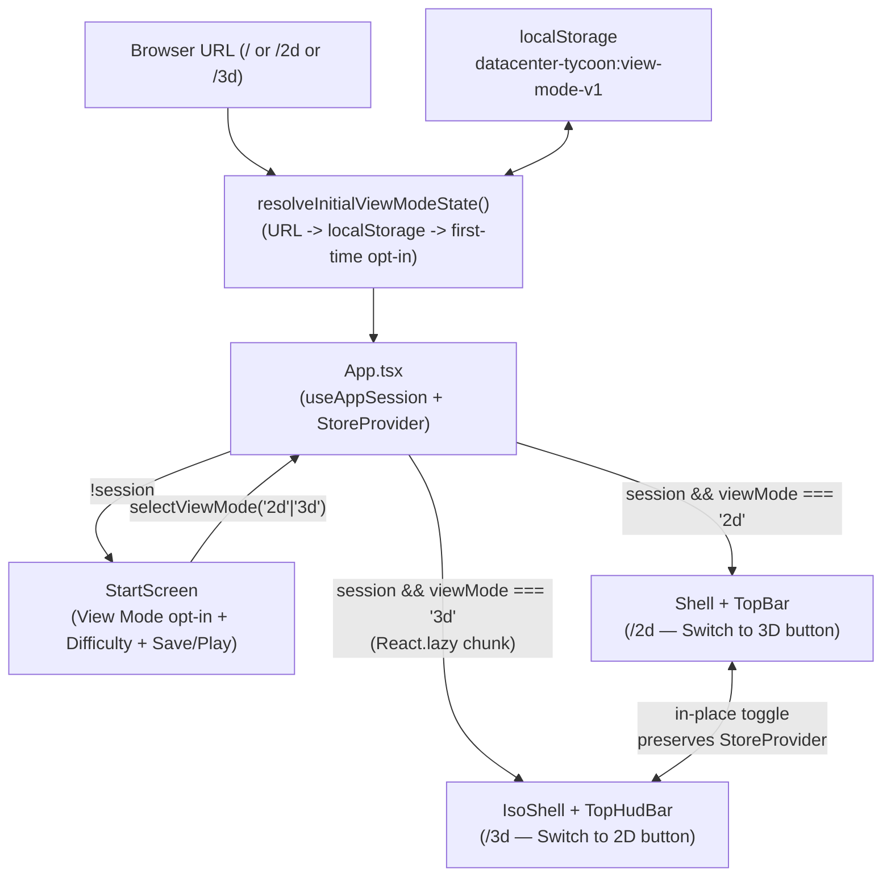

## Progress

- [x] **Phase 1 — Plan File & Branch Preparation**
  - [x] 1.1 Create `.agents/plans/054-unified-2d-3d-web-frontend.md` and update `.agents/plans/README.md`
- [x] **Phase 2 — Merge `packages/web-3d` Source & Tests into `packages/web`**
  - [x] 2.1 Move 3D engine, state, UI components, and tests into `packages/web/src` and update `test-setup.ts`
  - [x] 2.2 Rewrite `@datacenter-tycoon/web` self-imports in moved 3D files to direct relative imports and export 3D modules from `packages/web/src/index.ts`
- [ ] **Phase 3 — View Mode Preference (`localStorage`), `/2d` & `/3d` Routing, First-Time Opt-In, and In-Game Switching**
  - [ ] 3.1 Implement `viewModePreference.ts` + unit tests (`localStorage` preference + `/2d` & `/3d` pathname helpers)
  - [ ] 3.2 Add first-time View Mode opt-in & selector to `StartScreen.tsx`
  - [ ] 3.3 Add Switch to 3D button in 2D (`TopBar` / `Shell`) and Switch to 2D button in 3D (`TopHudBar` / `IsoShell`) + sync active DC across switches
  - [ ] 3.4 Wire `/2d` and `/3d` routing, `localStorage` preference, and lazy `IsoShell` into `packages/web/src/App.tsx` + `App.test.tsx`
- [ ] **Phase 4 — GitHub Pages `/2d` & `/3d` Static Entrypoints & Removing `packages/web-3d` + Railway 3D Demo**
  - [ ] 4.1 Generate `dist/2d/index.html`, `dist/3d/index.html`, and `dist/404.html` during `packages/web` Vite build
  - [ ] 4.2 Remove `packages/web-3d` workspace and remove `dctycoon-3d` from `.railway/railway.ts`, backend CORS allowlists, root `package.json`, and docs
- [ ] **Phase 5 — Full Monorepo Verification & Plan Completion**
  - [ ] 5.1 Run `typecheck`, `test`, `go test`, `audit:query-boundary`, `build`, `perf:budgets:strict`, `lint`, and verify dist output
  - [ ] 5.2 Mark plan completed and update `.agents/plans/README.md`

## Overview

Consolidate the 2D web client (`packages/web`) and the Cities: Skylines-inspired isometric 3D client (`packages/web-3d`) into a single unified application inside `packages/web`, served at `dctycoon.arnav.tech/2d` and `dctycoon.arnav.tech/3d`. Both views already share the same store, selectors, `localStorage` save format, online leaderboard verification controller, audio engine, `StartScreen`, and management modals/pages; merging them eliminates the separate `web-3d` workspace and Railway deployment while allowing zero-reload switching mid-game. First-time visitors opt into `2D Classic` or `3D Isometric` on the start screen, `localStorage` remembers their preferred mode across visits, and an explicit header/HUD toggle lets players switch freely between `/2d` and `/3d` while preserving their live session and active datacenter.

## Architecture



Key decisions:
- **Single origin, shared state**: Running 2D and 3D inside `packages/web` under the same `useAppSession()` / `<StoreProvider>` means switching `/2d` ↔ `/3d` preserves the active `GameStore`, simulation speed, audio engine, and `WebVerifiedRunController` in memory without losing progress or reloading.
- **Preference persistence**: `datacenter-tycoon:view-mode-v1` in `localStorage` stores `"2d"` or `"3d"`. Visiting `/2d` or `/3d` directly updates the stored preference; visiting `/` resolves the stored preference (if any) or presents a first-time View Mode opt-in selector on `StartScreen` defaulting to `"2d"`.
- **Code splitting for performance budgets**: `IsoShell` is loaded via `React.lazy(...)` so the main 2D bundle stays well within `checkPerfBudgets.mjs`'s 150 KB gzip limit.
- **GitHub Pages static SPA entrypoints**: A Vite `closeBundle()` plugin copies `dist/index.html` into `dist/2d/index.html`, `dist/3d/index.html`, and `dist/404.html`, so direct visits or refreshes on `https://dctycoon.arnav.tech/2d` and `https://dctycoon.arnav.tech/3d` return HTTP `200 OK`.
- **Electron compatibility**: History API pathname updates (`pushState`/`replaceState`) are gated on `http:` / `https:` protocols so `packages/desktop`'s `file://` renderer continues using `hashRouter`.

```ts
export type GameViewMode = "2d" | "3d";
export const VIEW_MODE_PREFERENCE_KEY = "datacenter-tycoon:view-mode-v1";
```

## Phase 1 — Plan File & Branch Preparation

**Goal**: Record the numbered implementation plan and create a dedicated feature branch.

### Step 1.1 — Create `.agents/plans/054-unified-2d-3d-web-frontend.md` and update `.agents/plans/README.md`
- Files: `.agents/plans/054-unified-2d-3d-web-frontend.md`, `.agents/plans/README.md`
- Create this plan document and index it in `.agents/plans/README.md`.
- Acceptance: Plan file and README index match `planning/SKILL.md` conventions.

## Phase 2 — Merge `packages/web-3d` Source & Tests into `packages/web`

**Goal**: Move all 3D engine, state, HUD, viewport, shell, and test files into `packages/web/src` without circular imports.

### Step 2.1 — Move 3D engine, state, UI components, and tests into `packages/web/src`
- Files: `packages/web/src/engine/*`, `packages/web/src/state/*`, `packages/web/src/ui/hud/*`, `packages/web/src/ui/modals/*`, `packages/web/src/ui/viewport/*`, `packages/web/src/ui/shell/IsoShell.*`, `packages/web/src/ui/query-boundary.test.ts`, `packages/web/src/test-setup.ts`
- Move all unique source and test files from `packages/web-3d/src` into `packages/web/src` (zero filename collisions).
- Upgrade `packages/web/src/test-setup.ts` with the extended Canvas 2D context mocks and `ResizeObserver` mock from `packages/web-3d/src/test-setup.ts`.
- Acceptance: Files are present in `packages/web/src` and `test-setup.ts` supports all 2D and 3D tests.

### Step 2.2 — Rewrite `@datacenter-tycoon/web` self-imports in moved 3D files and export 3D modules
- Files: moved files in `packages/web/src/engine/*`, `packages/web/src/ui/**/*`, and `packages/web/src/index.ts`
- Replace `from "@datacenter-tycoon/web"` imports with direct relative module paths (never importing from `index.ts` to avoid cycles).
- Re-export 3D modules (`engine/*`, `state/viewportState.js`, `IsoShell`) from `packages/web/src/index.ts`.
- Acceptance: `npm run test -w @datacenter-tycoon/web` and `npm run typecheck -w @datacenter-tycoon/web` pass with all 2D and 3D tests.

## Phase 3 — View Mode Preference (`localStorage`), `/2d` & `/3d` Routing, First-Time Opt-In, and In-Game Switching

**Goal**: Implement browser-persisted view preference, `/2d` and `/3d` URL routing, first-time start-screen opt-in, and one-click in-game view switching.

### Step 3.1 — Implement `viewModePreference.ts` + unit tests
- Files: `packages/web/src/store/viewModePreference.ts`, `packages/web/src/store/viewModePreference.test.ts`, `packages/web/src/index.ts`
- Implement `GameViewMode`, `VIEW_MODE_PREFERENCE_KEY`, `getStoredViewModePreference`, `writeStoredViewModePreference`, `parseViewModeFromPathname`, `buildViewModeUrl`, `syncViewModeHistory`, and `resolveInitialViewModeState`.
- Acceptance: Unit tests pass for URL parsing, `localStorage` read/write, first-time fallback, and `http:`/`https:` protocol gating.

### Step 3.2 — Add first-time View Mode opt-in & selector to `StartScreen.tsx`
- Files: `packages/web/src/ui/start/StartScreen.tsx`, `packages/web/src/ui/start/StartScreen.module.css`
- Add `selectedViewMode`, `isFirstTimeViewModeChoice`, and `onSelectViewMode` props to `StartScreen` with accessible `radiogroup` buttons for `2D CLASSIC` and `3D ISOMETRIC`.
- Acceptance: Start screen displays the first-time opt-in prompt when no preference is stored and reflects selection changes cleanly on desktop and mobile.

### Step 3.3 — Add Switch to 3D (`TopBar` / `Shell`) and Switch to 2D (`TopHudBar` / `IsoShell`) controls
- Files: `packages/web/src/ui/topbar/TopBar.tsx`, `TopBar.module.css`, `TopBar.test.tsx`, `packages/web/src/ui/shell/Shell.tsx`, `packages/web/src/ui/hud/TopHudBar.tsx`, `TopHudBar.module.css`, `hud.test.tsx`, `packages/web/src/ui/shell/IsoShell.tsx`, `IsoShell.test.tsx`
- Add `onSwitchTo3d` button in `TopBar` and `onSwitchTo2d` button in `TopHudBar`, wired through `Shell` and `IsoShell`.
- Sync the currently viewed datacenter between 2D hash routes (`#/dc/:dcId/...`) and 3D `IsoShell` facility state when toggling views.
- Acceptance: Unit tests verify switch buttons and callback invocation in both HUDs.

### Step 3.4 — Wire `/2d` & `/3d` routing, preference persistence, and lazy `IsoShell` into `App.tsx`
- Files: `packages/web/src/App.tsx`, `packages/web/src/App.module.css`, `packages/web/src/App.test.tsx`
- Lazy-load `IsoShell` with `React.lazy` + `Suspense`.
- Extend `useAppSession()` with `viewMode`, `hasStoredViewModePreference`, `selectViewMode`, `popstate` synchronization, and preference persistence on game start/load.
- Add tests covering first-time opt-in, returning `localStorage` preference, direct `/2d` & `/3d` URL loading, and live mid-game 2D ↔ 3D switching.
- Acceptance: `App.test.tsx` and full `@datacenter-tycoon/web` suite pass.

## Phase 4 — GitHub Pages `/2d` & `/3d` Static Entrypoints & Removing `packages/web-3d` + Railway 3D Demo

**Goal**: Publish `/2d` and `/3d` cleanly via GitHub Pages and remove the redundant `packages/web-3d` workspace and `dctycoon-3d` Railway service.

### Step 4.1 — Generate `dist/2d/index.html`, `dist/3d/index.html`, and `dist/404.html` during Vite build
- Files: `packages/web/vite.config.ts`
- Add `githubPagesSpaRoutes()` Vite plugin with `closeBundle()` copying `dist/index.html` to `dist/2d/index.html`, `dist/3d/index.html`, and `dist/404.html`.
- Acceptance: `npm run build -w @datacenter-tycoon/web` outputs all four entrypoints and `npm run perf:budgets:strict -w @datacenter-tycoon/web` passes.

### Step 4.2 — Remove `packages/web-3d` workspace and retire `dctycoon-3d` from Railway & CORS configs
- Files: `packages/web-3d/**` (deleted), `package.json`, `package-lock.json`, `.railway/railway.ts`, `packages/server-go/internal/config/config.go`, `packages/server-go/internal/config/config_test.go`, `packages/server/src/config.ts`, `packages/server/src/index.test.ts`, `packages/server/README.md`, `packages/web/AGENTS.md`, `packages/web/README.md`
- Delete `packages/web-3d` and remove its workspace/scripts/query-boundary references from root `package.json` and `package-lock.json`.
- Remove `dctycoon3d` from `.railway/railway.ts` and `https://dctycoon-3d.up.railway.app` from Go & TS server CORS allowlists.
- Update `packages/web/AGENTS.md` and `packages/web/README.md` for `/2d` & `/3d`.
- Acceptance: `npm install`, `npm run typecheck`, Go tests, and `audit:query-boundary` succeed; no live code references `web-3d` or `dctycoon-3d`.

## Phase 5 — Full Monorepo Verification & Plan Completion

**Goal**: Verify every workspace builds, passes tests, passes strict perf budgets, and close out Plan 054.

### Step 5.1 — Run full verification suite across all workspaces
- Commands: `npm run typecheck`, `npm run test`, `cd packages/server-go && go test ./...`, `npm run audit:query-boundary`, `npm run build`, `npm run perf:budgets:strict -w @datacenter-tycoon/web`, `npm run lint`, and check `packages/web/dist` contents.
- Acceptance: All commands exit 0 and `rg "web-3d|dctycoon-3d" --glob "!.agents/plans/**"` has 0 matches.

### Step 5.2 — Mark Plan 054 completed
- Files: `.agents/plans/054-unified-2d-3d-web-frontend.md`, `.agents/plans/README.md`
- Tick all checkboxes and set `status: completed`.
- Acceptance: Plan and README index updated.

## References

- [AGENTS.md](../../AGENTS.md)
- [packages/web/AGENTS.md](../../packages/web/AGENTS.md)
- [Plan 053 — Isometric 3D Web Client](./053-isometric-3d-web-client.md)
- [.github/workflows/deploy-web.yml](../../.github/workflows/deploy-web.yml)
- [.railway/railway.ts](../../.railway/railway.ts)

## Changelog

- 2026-11-17 — created and started on branch `feature/plan-054-unified-2d-3d`.
